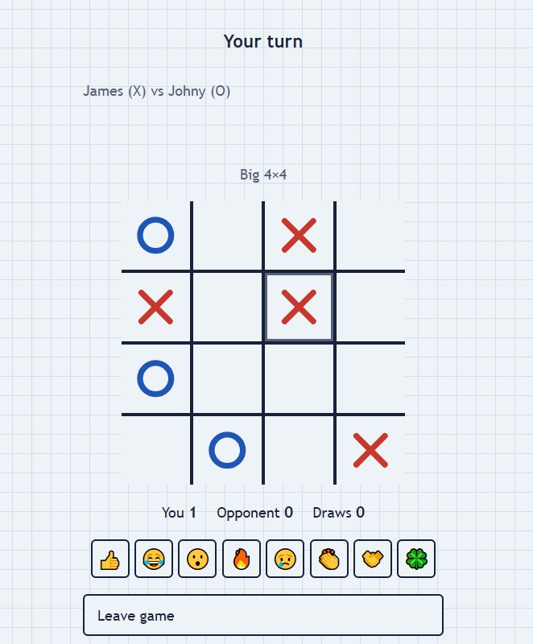
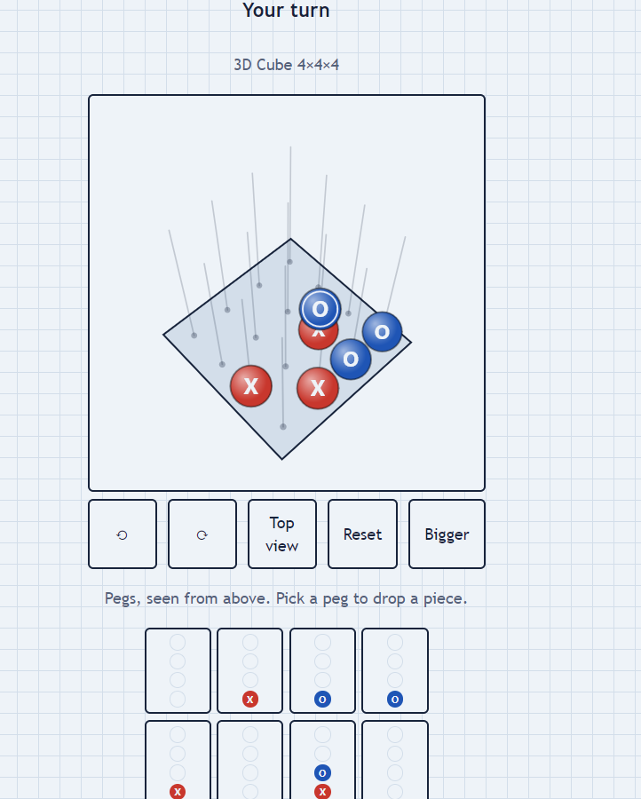
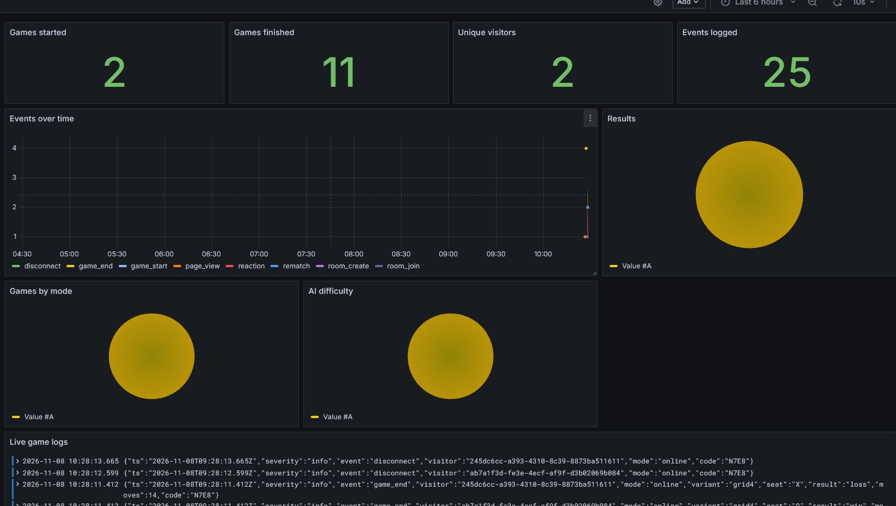
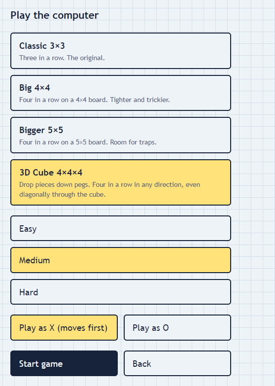
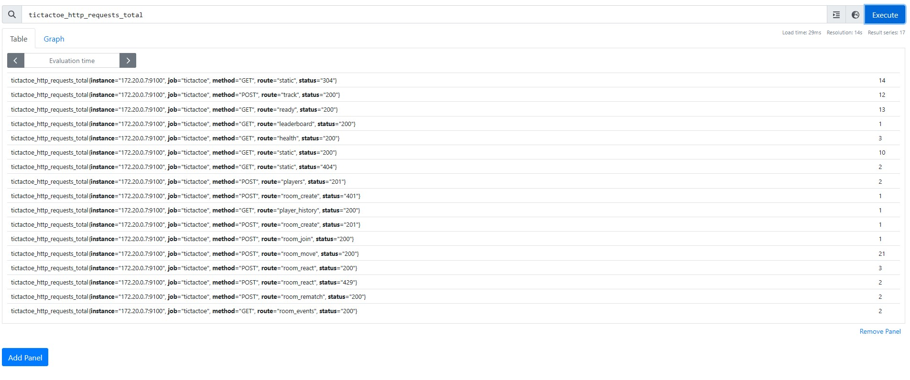
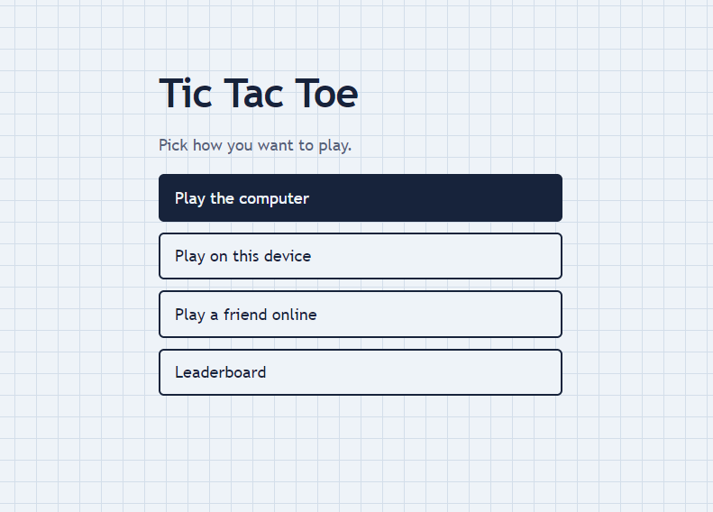

# Tic Tac Toe
Vibe coded to test out some AI agents.  \
Image gallery at the bottom.

Four board types (Classic 3×3, Big 4×4, Bigger 5×5, and a 3D Cube 4×4×4 with gravity). Single player (Easy, Medium, Hard AI), local two-player, and online rooms with guest nicknames, match history, a leaderboard, and emoji reactions.

## Run with Docker (recommended)

    docker compose up -d --build                         # game + Postgres (http://localhost:8080)
    docker compose --profile observability up -d --build # also Grafana, Loki, Alloy

- Game: http://localhost:8080 (with `--profile redis`, also :8081 and :8082 sharing rooms)
- Grafana and Prometheus (observability profile only): http://localhost:3001 and http://localhost:9090

Copy `.env.example` to `.env` to set passwords. Stop with `docker compose down` (add `-v` to delete data).

## Run without Docker

Needs Node 22.18 or newer. The database is optional.

    npm install
    npm run build
    npm start                 # http://localhost:3000
    # with a database: DATABASE_URL=postgresql://... npm start

## Scripts

| Command | What it does |
|---|---|
| `npm run build` | Compiles `shared/` and `server/` TypeScript to `dist/` |
| `npm run typecheck` | Type-checks everything, including tests |
| `npm test` | Builds, then runs the tests (set `TEST_DATABASE_URL` to include the real-database test) |
| `npm run dev` | Builds, then runs the server from source and restarts on changes |

## Layout

- `shared/` game rules, AI, and the types shared with the browser (TypeScript, compiled to `dist/shared/`)
- `server/` HTTP server, rooms, Postgres storage (TypeScript)
- `client/` browser UI (plain JavaScript, no build step)
- `migrations/` versioned SQL, applied automatically at startup
- `test/` tests, written in TypeScript and run directly by Node
- `.github/` CI, release, CodeQL, and Dependabot configuration
- `docs/PLAN.md` the original plan

## Notes

- TypeScript is written in "erasable syntax only" style, so Node can run `.ts` files directly (used by tests and `dev`). Production runs the compiled output.
- Rooms live in memory by default, so run **one** server instance. To run several, use Redis (see `REDIS.md`).
- Disconnected players have 60 seconds to return before they forfeit. Requests are rate limited per IP. Set `TRUST_PROXY=1` only behind a reverse proxy you control.
- Before the first push to GitHub, run `npm install` once and commit `package-lock.json`, because CI uses `npm ci`.
- See `REDIS.md`, `DATABASE.md`, `OBSERVABILITY.md`, and `CICD.md`.

## Board types

| Board | Rules |
|---|---|
| Classic 3×3 | Three in a row |
| Big 4×4 | Four in a row |
| Bigger 5×5 | Four in a row |
| 3D Cube 4×4×4 | 16 pegs, each holds 4 pieces. Pick a peg and the piece drops to the lowest free slot. Four in a row in any direction wins, including diagonals through the cube (76 possible lines) |

The cube is drawn on a plain canvas (no 3D library): drag to turn it, tap a peg to play. Under it are 16 peg buttons, which is how keyboards and screen readers play. Hard AI is exact on 3×3 and a time-limited search on the others.

The game rules live in `shared/game.ts` and every board type uses the same engine, so adding a board type means adding one entry there.

  
  
  
  
  
  

